## Практична робота №2.6

### Інтерфейс та навігація застосунку Smart Life

### Опис реалізованого функціоналу

У цій практичній роботі було продовжено розробку застосунку Smart Life. Було вдосконалено інтерфейс, додано нові можливості та розширено навігацію між екранами.

Для створення інтерфейсу використовувався Jetpack Compose, а для переходів між екранами – Navigation Compose.

### Демонстрація роботи

### 1. Екран авторизації

Під час запуску застосунку користувач потрапляє на екран авторизації. На ньому розміщено логотип Smart Life, поля для введення логіна та пароля, кнопку входу й посилання для переходу до реєстрації.

Також передбачено можливість перегляду введеного пароля за допомогою відповідної іконки.

**Рисунок 1 – Екран авторизації застосунку Smart Life.**

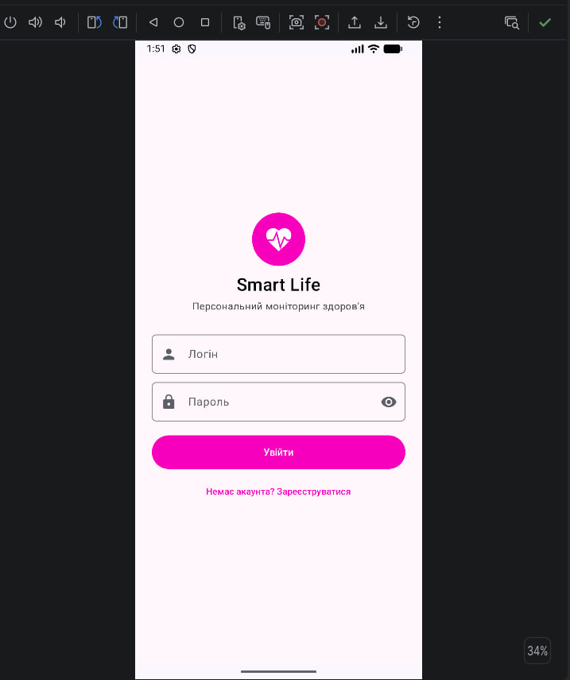

### 2. Головний екран

На головному екрані відображаються основні показники користувача: кількість випитої води, пульс, тривалість сну та вага. Також є блок з останніми записами та кнопка для додавання нової інформації.

У верхньому меню додано пункт «Про застосунок», після натискання на який відкривається інформаційне діалогове вікно.

**Рисунок 2 – Головний екран застосунку.**

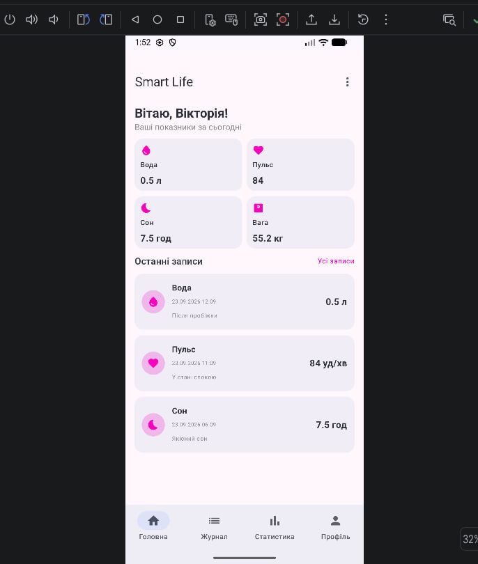

**Рисунок 3 – Діалогове вікно «Про застосунок».**

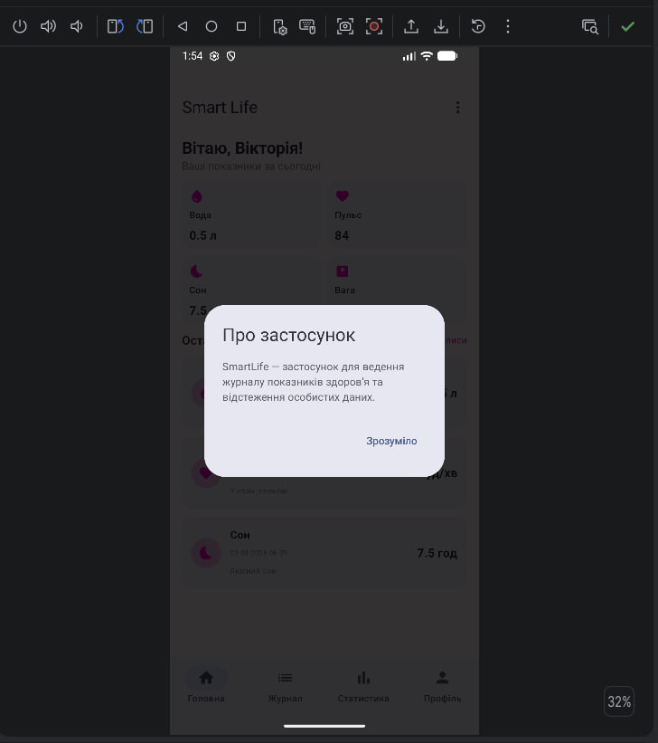

### 3. Журнал записів

Створено окремий екран для перегляду всіх доданих записів. Кожен запис відображається у вигляді картки з типом показника, його значенням та приміткою.

Після натискання на картку можна перейти до детальної інформації про відповідний запис. Також на екрані є кнопка додавання нового запису.

**Рисунок 4 – Екран журналу записів.**

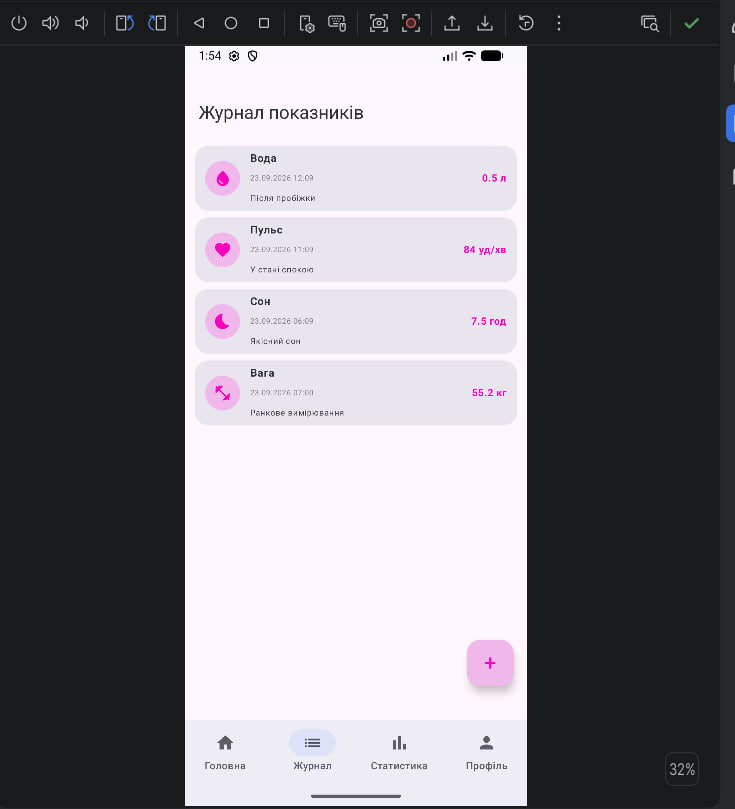

### 4. Додавання нового запису

Реалізовано діалогове вікно для додавання нових показників. Користувач може вибрати одну з п'яти категорій: вода, пульс, вага, сон або настрій, ввести значення та за бажанням додати примітку.

Залежно від вибраної категорії змінюється підпис поля та одиниця вимірювання. Також додано перевірку введених даних, щоб значення не було порожнім або меншим чи рівним нулю.

Після збереження новий запис додається до списку.

**Рисунок 5 – Діалогове вікно додавання запису.**

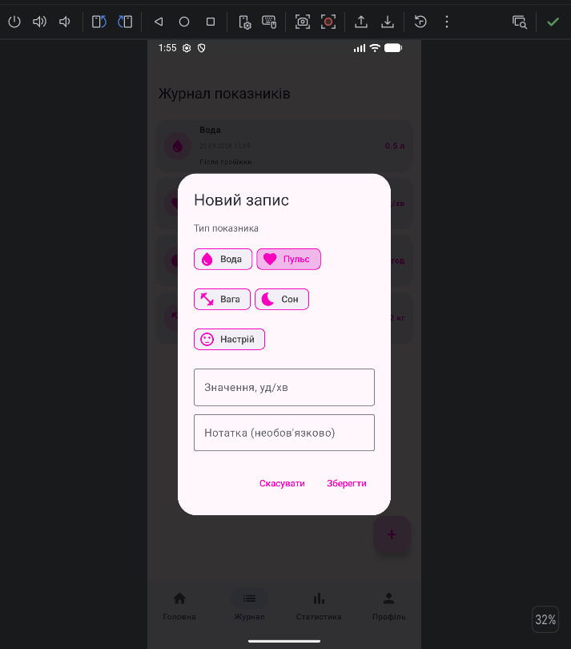

### 5. Детальна інформація про запис

Після вибору запису в журналі відкривається окремий екран, на якому відображаються його тип, ідентифікатор, значення та примітка.

Також додано кнопку «Поділитися». Після її натискання інформація про запис відображається у вигляді повідомлення Snackbar.

**Рисунок 6 – Екран детальної інформації про запис.**

**Рисунок 7 – Повідомлення після натискання кнопки «Поділитися».**

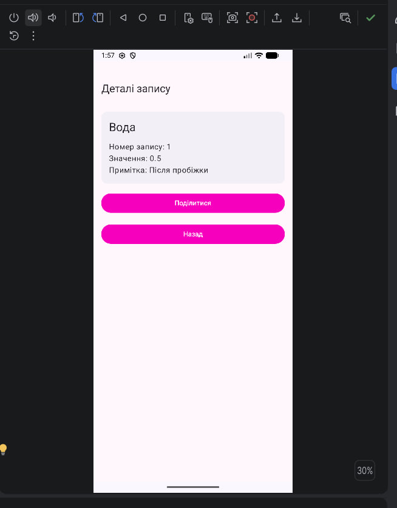

### 6. Профіль користувача

Створено окремий екран профілю, на якому відображається інформація про користувача. Також додано кнопку «Вийти з акаунта», яка повертає користувача до екрана авторизації.

**Рисунок 8 – Екран профілю.**

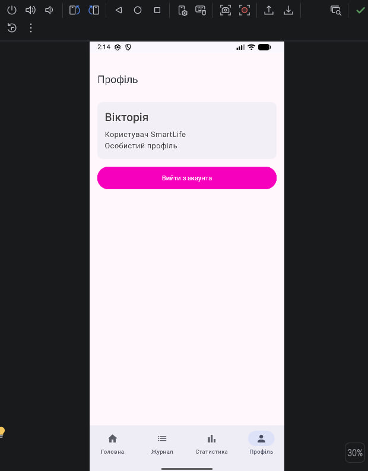

### 7. Екран статистики

Додано новий екран «Статистика», на якому відображається загальна кількість записів та інформація за окремими категоріями.

Для кожного типу показника показано кількість записів і середнє значення, якщо дані наявні. Інформація розміщена в окремих картках з відповідними іконками.

**Рисунок 9 – Екран статистики.**

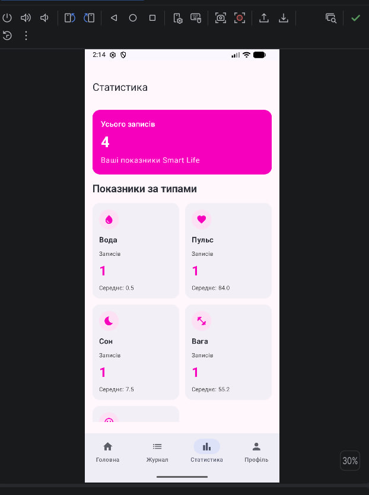

### 8. Навігація між екранами

Для переходу між основними розділами застосунку додано нижню панель навігації з чотирма вкладками: «Головна», «Записи», «Статистика» та «Профіль».

Для реалізації переходів використано Navigation Compose. Також налаштовано передачу ідентифікатора запису під час переходу до екрана з детальною інформацією.

**Рисунок 10 – Нижня панель навігації.**

### 9. Фільтрація записів

На екрані журналу додано можливість фільтрувати записи за їхнім типом. Для цього над списком розміщено кнопки категорій: вода, пульс, вага, сон і настрій.

Після вибору певної категорії у списку залишаються тільки записи відповідного типу. Також можна скинути фільтр і знову переглянути всі записи.

Для реалізації цієї функції використано StateFlow, який зберігає вибрану категорію та дозволяє автоматично оновлювати список після зміни фільтра.

**Рисунок 11-12 – Фільтрація записів за типом показника.**

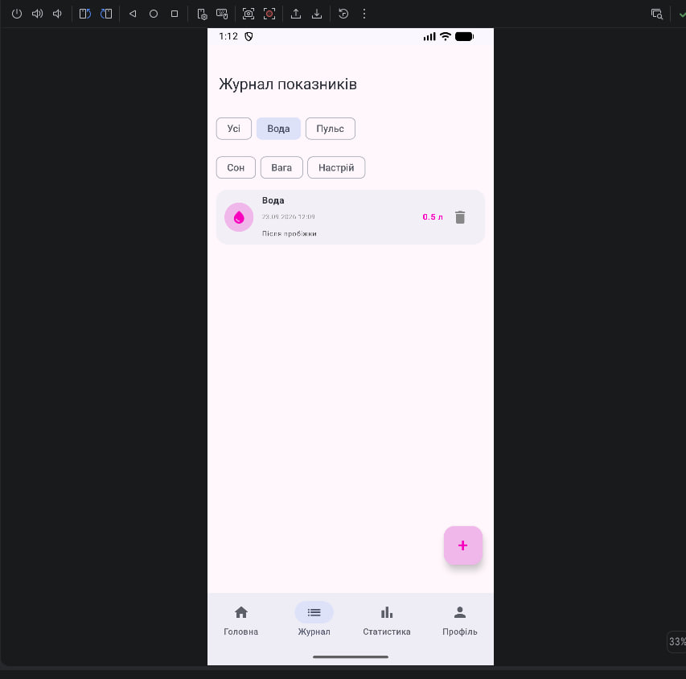

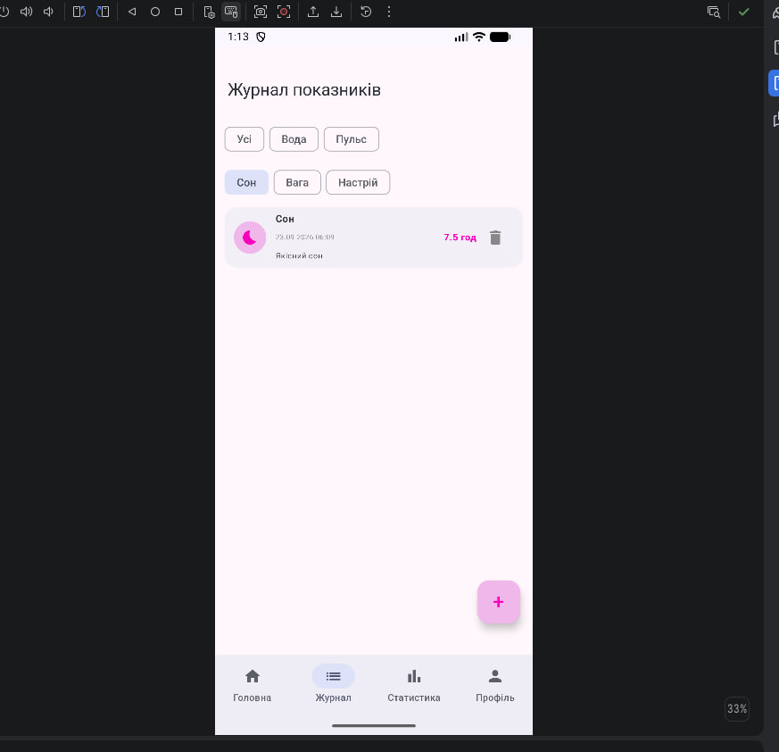

### 10. Видалення та відновлення записів

На екрані журналу також додано можливість видаляти записи. Після видалення внизу екрана з'являється повідомлення Snackbar із кнопкою «Скасувати».

Якщо користувач натисне цю кнопку, видалений запис повернеться до списку на своє попереднє місце.

**Рисунок 13 – Повідомлення про видалення запису з можливістю скасування.**

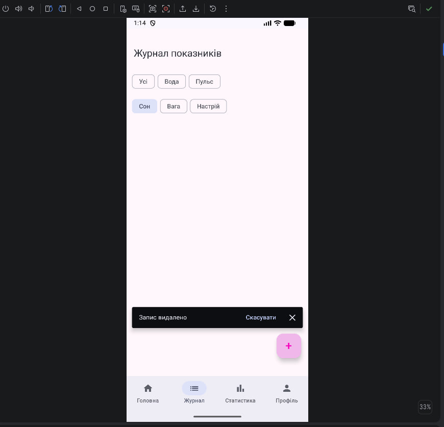

### 11. Архітектура застосунку

Для роботи із записами було створено Repository, який відповідає за отримання, додавання, оновлення та видалення даних.

Спочатку створено інтерфейс RecordRepository, у якому описано основні методи роботи із записами. Його реалізацію виконує клас InMemoryRecordRepository, де дані зберігаються за допомогою MutableStateFlow.

Також додано метод observeRecordsByType(type), який дозволяє отримувати записи лише вибраної категорії.

Для роботи зі станом журналу використовується RecordsViewModel. Він звертається до Repository, отримує записи та передає вибраний тип фільтра. Завдяки цьому список автоматично оновлюється після зміни категорії.

Для керування залежностями спочатку використовувався ручний DI: клас AppContainer створював Repository, а RecordsViewModelFactory передавав його до RecordsViewModel.

Пізніше ручне створення залежностей було замінено на Hilt. Для цього додано клас SmartLifeApplication з анотацією @HiltAndroidApp, модуль RepositoryModule для прив'язки RecordRepository до InMemoryRecordRepository, а також анотації @HiltViewModel та @Inject для RecordsViewModel.

Тепер залежності створюються та передаються автоматично, а для отримання RecordsViewModel у Compose використовується hiltViewModel().

#### Порівняння ручного DI та Hilt

Під час роботи було порівняно два способи керування залежностями.

У варіанті з ручним DI використовувалися два файли: AppContainer.kt (6 рядків) та RecordsViewModelFactory.kt (15 рядків). Загалом вони містили 21 рядок коду.

Після переходу на Hilt було створено SmartLifeApplication.kt (5 рядків) та RepositoryModule.kt (17 рядків), що разом становить 22 рядки.

Таким чином, кількість рядків у цих файлах майже не змінилася. Проте Hilt дозволяє автоматизувати створення та передачу залежностей і не потребує окремої фабрики для ViewModel.

### Контрольні питання

**1. Чим декларативний UI відрізняється від імперативного?**

В імперативному підході розробник самостійно змінює елементи інтерфейсу, наприклад встановлює текст або оновлює список. У декларативному підході описується, як має виглядати інтерфейс залежно від поточного стану. У Jetpack Compose після зміни даних інтерфейс оновлюється автоматично за допомогою рекомпозиції.

**2. Для чого потрібні модифікатори і чи важливий їх порядок?**

Модифікатори (`Modifier`) використовуються для налаштування розміру, відступів, зовнішнього вигляду та поведінки елементів. Їх порядок важливий, оскільки вони застосовуються послідовно та можуть впливати на результат.

**3. Чому для довгих списків використовують LazyColumn?**

`LazyColumn` створює лише ті елементи списку, які потрібні для відображення на екрані. Це допомагає ефективніше використовувати ресурси та працювати з великими списками.

**4. Як передати аргумент між екранами в Navigation Compose?**

Для цього використовують маршрут із параметрами. Наприклад, у Smart Life для переходу до деталей запису використовується `RecordDetailsRoute(recordId)`, де передається ідентифікатор запису. На іншому екрані його можна отримати за допомогою `toRoute()`.

**5. Що робить popUpTo?**

`popUpTo` видаляє екрани зі стеку навігації до вказаного маршруту. Наприклад, після авторизації можна видалити екран входу, щоб користувач не повертався до нього кнопкою «Назад».

**6. Чим remember відрізняється від rememberSaveable?**

`remember` зберігає значення між рекомпозиціями, але не переживає поворот екрана. `rememberSaveable` також зберігає прості значення після перестворення Activity, наприклад під час повороту екрана.

**7. Чому ViewModel переживає поворот екрана?**

ViewModel має довший життєвий цикл, ніж Activity. Тому під час повороту екрана Activity створюється повторно, а ViewModel зберігається разом зі своїм станом.

**8. Що таке підйом стану?**

Підйом стану (State Hoisting) — це винесення стану з composable-функції до її батьківського компонента. Дочірній компонент отримує значення стану та функцію для його зміни через параметри.

**9. Навіщо розділяти MutableStateFlow і StateFlow?**

`MutableStateFlow` використовується всередині ViewModel для зміни стану, а назовні передається `StateFlow`, який дозволяє спостерігати за змінами, але не змінювати їх напряму.

**10. Чому стан має бути незмінним?**

Незмінний стан допомагає Compose правильно визначати зміни та оновлювати інтерфейс. Замість зміни наявних даних створюється новий об'єкт або список з оновленими значеннями.

**11. Які шари виділяють в архітектурі Android-застосунку?**

У методичці виділено два основні шари:
- UI — відповідає за інтерфейс користувача та відображення даних.
- Data — відповідає за отримання, зберігання та зміну даних.

Також використовується архітектурний шаблон MVVM, у якому ViewModel керує станом екрана та взаємодіє з репозиторієм.

**12. Навіщо ViewModel залежить від інтерфейсу репозиторію, а не від класу?**

Інтерфейс визначає доступні операції, але не прив'язує ViewModel до конкретної реалізації. Завдяки цьому можна замінити реалізацію репозиторію без зміни логіки ViewModel. Це також спрощує тестування.

**13. Що таке єдине джерело правди?**

Це принцип, за яким кожен тип даних має одного власника. У Smart Life таким джерелом є Repository, через який різні екрани отримують однакові актуальні дані.

**14. Для чого потрібна фабрика ViewModel?**

`ViewModelProvider.Factory` використовується для створення ViewModel, які мають параметри в конструкторі. Фабрика отримує необхідні залежності, наприклад Repository, і передає їх у ViewModel. У нашому застосунку ручну фабрику згодом замінено на Hilt.

**15. Що робить stateIn з WhileSubscribed?**

`stateIn` перетворює холодний `Flow` на гарячий `StateFlow` з початковим значенням. `SharingStarted.WhileSubscribed(5_000)` означає, що потік продовжує працювати, поки є підписники, а після зникнення останнього підписника зупиняється через 5 секунд. Така затримка допомагає уникнути зайвого перезапуску підписки під час повороту екрана.

