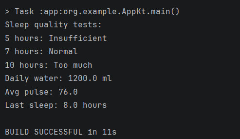

# Звіт з практичних робіт

## Практична робота №1
### Середовище розробки і перший застосунок

**Практичне завдання:** 1.6

### Опис реалізованого функціоналу

Створено Android-застосунок HelloMobile з використанням Kotlin та Jetpack Compose. Реалізовано відображення привітання, кнопку збільшення лічильника натискань, повідомлення після досягнення 10 натискань і кнопку скидання лічильника до нуля.

### Демонстрація роботи

**Рисунок 1 — Початковий вигляд застосунку.**

**Рисунок 2 — Застосунок після 10 натискань.**

**Рисунок 3 — Робота кнопки скидання.**

### Демонстрація зміни колірної теми

Застосунок підтримує відображення інтерфейсу у світлій і темній колірних темах.

**Рисунок 4 — Інтерфейс застосунку у світлій темі.**

## Практична робота №2

### Опис реалізованого функціоналу

Розроблено консольну програму мовою Kotlin для роботи із записами про стан здоров'я. Реалізовано функцію визначення якості сну, класи даних для зберігання інформації та функцію-розширення для обчислення загальної кількості спожитої води, середнього пульсу й тривалості останнього сну.

### Демонстрація роботи

**Рисунок 5 — Результат виконання програми KotlinBasics у консолі.**

## Контрольні питання

### 1. Чим нативний застосунок відрізняється від кросплатформного?

Нативний застосунок створюється для конкретної платформи з використанням її мов та інструментів, наприклад Kotlin для Android і Swift для iOS. Кросплатформна розробка дозволяє використовувати один спільний код для кількох платформ.

### 2. Яке призначення Gradle і файлу `libs.versions.toml`?

Gradle — система збірки, яка використовується для компіляції та збирання Android-проєктів. Файл `libs.versions.toml` містить версії бібліотек в одному місці та спрощує керування залежностями.

### 3. Що описує `AndroidManifest.xml`?

`AndroidManifest.xml` — це своєрідний паспорт застосунку. У ньому вказуються назва, іконка, Activity та дозволи.

### 4. Назвіть методи життєвого циклу Activity.

Основні методи життєвого циклу Activity:
- `onCreate()` — створення Activity;
- `onStart()` — перехід до видимого стану;
- `onResume()` — Activity стає активною;
- `onPause()` — Activity втрачає активний стан;
- `onStop()` — Activity більше не відображається;
- `onRestart()` — повторний запуск після стану Stopped;
- `onDestroy()` — знищення Activity.

### 5. Що таке стан у Compose і як він пов’язаний з рекомпозицією?

Стан (state) — це дані, від яких залежить вигляд інтерфейсу. Коли стан змінюється, Compose повторно викликає відповідні composable-функції. Цей процес називається рекомпозицією.

### 6. Чим `val` відрізняється від `var`?

`val` використовується для оголошення незмінного посилання на значення, а `var` — змінного. У Kotlin рекомендовано за замовчуванням використовувати `val`.

### 7. Що генерує компілятор для `data class`?

Для `data class` компілятор автоматично генерує методи `equals()`, `hashCode()`, `toString()` і `copy()`.

### 8. Як працюють оператори `?.` і `?:`?

Оператор `?.` виконує безпечний виклик: якщо значення дорівнює `null`, повертається `null`. Оператор `?:` (Елвіса) дозволяє задати значення за замовчуванням, якщо результат дорівнює `null`.

### 9. Чим `filter` відрізняється від `map`?

`filter` відбирає елементи колекції, які відповідають заданій умові. `map` перетворює кожен елемент колекції та формує нову колекцію.

### 10. Коли доречно використовувати `enum class`?

`enum class` використовується для опису обмеженого набору можливих значень, наприклад типів записів: вода, пульс і сон.

