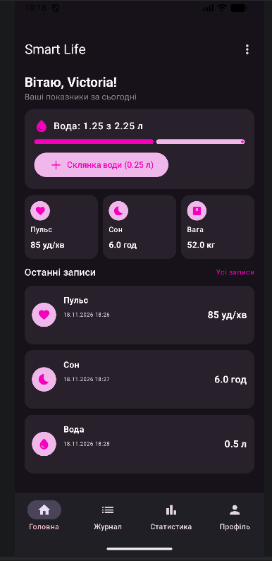
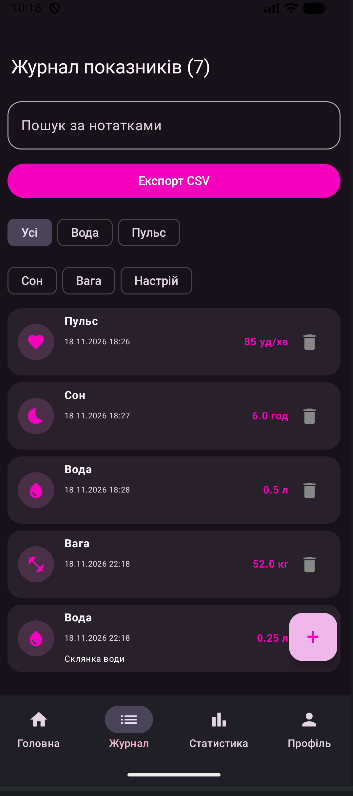
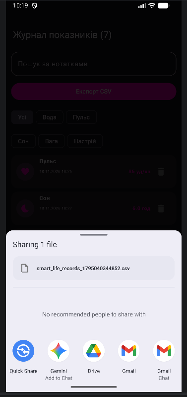
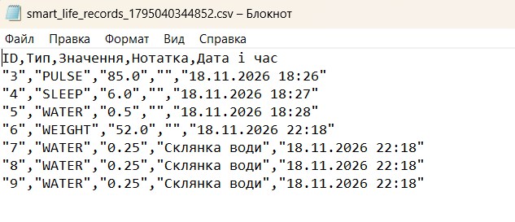
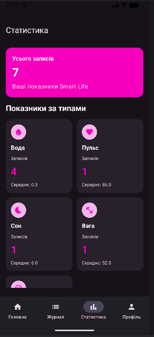
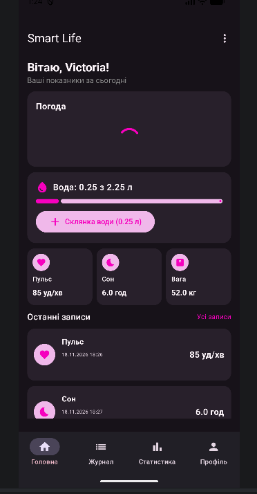
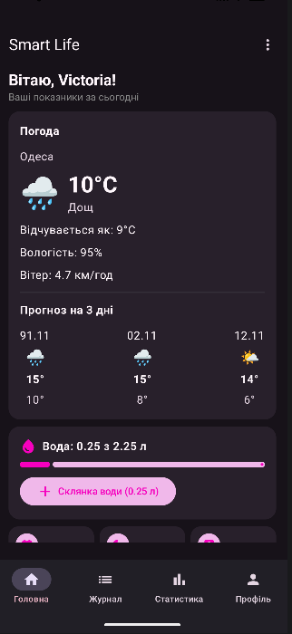
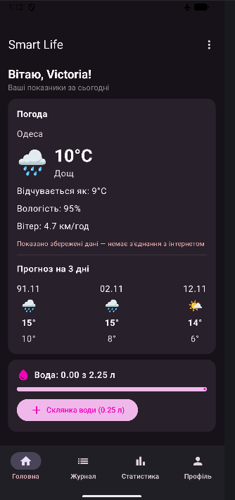

## Практична робота №3.6

### Корутини і локальні дані

### Опис реалізованого функціоналу

У цій практичній роботі було продовжено розробку застосунку Smart Life. Було реалізовано збереження даних користувача та показників здоров'я у локальній базі даних, додано пошук і фільтрацію записів, а також можливість експорту даних у CSV-файл.

Для роботи з локальними даними використовувалися Room та DataStore Preferences. Для асинхронного виконання операцій і спостереження за змінами даних застосовувалися Kotlin Coroutines та Flow.

### Демонстрація роботи

### 1. Головний екран

На головному екрані відображаються основні показники користувача: кількість випитої води, пульс, тривалість сну та вага. Також показано денну норму води, прогрес її виконання та останні додані записи.

Додатково реалізовано можливість швидкого додавання склянки води за допомогою відповідної кнопки.

**Рисунок 1 – Головний екран застосунку Smart Life**

### 2. Журнал показників

На екрані журналу відображаються всі додані користувачем записи. Для кожного запису показано його тип, значення, дату та час додавання, а також примітку, якщо вона була вказана.

Для роботи із записами реалізовано пошук за текстом примітки та фільтрацію за типом показника. Також користувач може видаляти записи.

**Рисунок 2 – Журнал показників із пошуком та фільтрацією**

### 3. Експорт записів у CSV

Для збереження та подальшого використання даних реалізовано експорт записів у формат CSV. Після натискання кнопки «Експорт CSV» формується файл із даними журналу, який можна передати через системне меню поширення Android.

Для передавання файлу використовується FileProvider, який надає доступ до створеного файлу іншим застосункам.

**Рисунок 3 – Системне меню поширення CSV-файлу**

**Рисунок 4 – Вміст експортованого CSV-файлу**

### 4. Екран статистики

На екрані статистики відображається загальна кількість записів та інформація за окремими типами показників.

Для кожної категорії показано кількість записів і середнє значення. Дані розміщені в окремих картках із відповідними іконками.

**Рисунок 5 – Екран статистики показників**

### 5. Налаштування профілю та DataStore Preferences

На екрані налаштувань профілю реалізовано можливість змінювати ім'я користувача, тему оформлення застосунку та денну норму води.

Для збереження цих параметрів використовується DataStore Preferences. Завдяки цьому налаштування зберігаються після закриття та повторного запуску застосунку.

Також додано три варіанти оформлення: системна тема, світла та темна.

**Рисунок 6 – Екран налаштувань профілю в темній темі**

**Рисунок 7 – Екран налаштувань профілю у світлій темі**

### 6. Робота з локальною базою даних Room

Для зберігання показників здоров'я було реалізовано локальну базу даних Room.

Створено сутність RecordEntity, яка містить ідентифікатор запису, тип показника, значення, примітку та дату й час додавання.

Для взаємодії з базою даних створено RecordDao. У ньому реалізовано такі операції:

- отримання всіх записів;
- отримання записів за вибраним типом;
- пошук записів за текстом примітки за допомогою SQL-запиту LIKE;
- додавання та оновлення записів;
- видалення записів за ідентифікатором;
- додавання декількох записів одночасно

Для отримання списків використовується Flow, а операції додавання та оновлення виконуються за допомогою suspend-функцій.

Створено клас AppDatabase, який відповідає за налаштування бази даних, а для її підключення використовується Hilt.

### 7. Архітектура роботи з даними

Для взаємодії з джерелом даних використовується Repository. Було створено інтерфейс RecordRepository та його реалізацію RoomRecordRepository, яка працює з Room через RecordDao.

RecordsViewModel отримує дані з репозиторію, керує пошуком і фільтрацією записів, а також виконує операції додавання, видалення та відновлення записів.

Для спостереження за змінами даних використовуються Flow та StateFlow. Це дозволяє автоматично оновлювати інтерфейс після зміни записів.

Для керування залежностями використовується Hilt. Створено модулі DatabaseModule та RepositoryModule, які відповідають за надання екземплярів бази даних і репозиторію.

Таким чином, дані зберігаються локально, а після повторного запуску застосунку раніше додані записи залишаються доступними.

### 8. Мережа і REST API

У другій частині практичної роботи було реалізовано отримання погодних даних із зовнішнього сервера за допомогою REST API. Для цього було використано сервіс Open-Meteo, який надає погодну інформацію без необхідності використання API-ключа.

Для виконання HTTP-запитів було підключено бібліотеки Retrofit та OkHttp, а для перетворення отриманої JSON-відповіді у Kotlin-об'єкти - Kotlin Serialization.

### 8.1 Підключення та налаштування мережі

Спочатку було додано дозвіл INTERNET у файл AndroidManifest.xml, який необхідний для доступу застосунку до мережі.

У файлі build.gradle.kts було підключено необхідні залежності Retrofit, OkHttp, logging-interceptor та конвертер Kotlin Serialization. Також було налаштовано BuildConfig і додано змінну WEATHER_BASE_URL з адресою сервера Open-Meteo.

Для налаштування мережевого з'єднання було створено NetworkModule. У ньому налаштовано OkHttpClient із тайм-аутами підключення, читання та запису тривалістю 15 секунд. Також додано HttpLoggingInterceptor для перегляду HTTP-запитів і відповідей у Logcat.

### 8.2. Отримання та обробка погодних даних

У пакеті data/remote було створено інтерфейс WeatherApi, у якому описано GET-запит до адреси v1/forecast. Для запиту використовуються координати Одеси, а також параметри поточної погоди та прогнозу на три дні.

Для обробки відповіді сервера було створено DTO-класи WeatherResponseDto, CurrentWeatherDto та DailyWeatherDto. За допомогою анотацій @Serializable та @SerialName визначено відповідність між полями JSON-відповіді та властивостями Kotlin-класів.

Також було створено WeatherRepository, який отримує відповідь від API та перетворює її на модель Weather для подальшого використання в застосунку.

### 8.3. Обробка станів завантаження

Для відображення результатів мережевого запиту було створено sealed interface WeatherUiState із трьома станами: Loading, Success та Error.

У HomeViewModel реалізовано функцію loadWeather(), яка виконує запит за допомогою viewModelScope. Під час завантаження встановлюється стан Loading, після успішного отримання даних — Success, а у разі помилки — Error.

Для перетворення мережевих помилок на зрозумілі повідомлення користувачу було створено NetworkErrors.kt. Також CancellationException обробляється окремо та повторно передається далі, щоб не порушувати роботу корутин.

### 8.4. Відображення погоди на головному екрані

На головному екрані застосунку було додано картку погоди WeatherCard. У ній відображаються поточна температура, температура за відчуттями, вологість, швидкість вітру та опис погодних умов.

Також було реалізовано прогноз на три дні з відображенням мінімальної та максимальної температури. Для цього до запиту API додано параметр daily з відповідними показниками.

**Рисунок 8 – Завантаження погодних даних**

**Рисунок 9 – Відображення поточної погоди та прогнозу на три дні**

### 8.5. Кешування погодних даних

Як завдання для самостійної роботи було реалізовано збереження останніх успішно отриманих погодних даних у DataStore Preferences.

Після отримання відповіді від сервера погодні дані перетворюються на модель Weather, серіалізуються у формат JSON та зберігаються в DataStore Preferences. Якщо під час наступного запиту відсутнє підключення до інтернету, застосунок використовує збережені дані замість повторного отримання інформації із сервера.

Для позначення того, що відображаються неактуальні дані, у картці погоди додано відповідне повідомлення.

Роботу кешування було перевірено на емуляторі: після успішного завантаження погоди було ввімкнено режим польоту та повторно запущено застосунок. Збережені погодні дані залишилися доступними, а на екрані з'явилося повідомлення про відсутність з'єднання з інтернетом.

**Рисунок 10 – Відображення збережених погодних даних без підключення до інтернету**

### Контрольні питання

**1. Коли використовувати DataStore, а коли базу даних?**

DataStore використовується для зберігання невеликої кількості простих даних у форматі «ключ - значення», наприклад налаштувань користувача, теми оформлення або денної норми води.

Room використовується для зберігання структурованих даних, які складаються з окремих записів і потребують пошуку, фільтрації, оновлення та видалення. У застосунку Smart Life DataStore використовується для налаштувань профілю, а Room - для зберігання показників здоров'я.

**2. Яке призначення @Entity, @Dao, @Database?**

Ці анотації використовуються під час роботи з бібліотекою Room:

- `@Entity` позначає клас, який представляє таблицю бази даних
- `@Dao` позначає інтерфейс або клас, у якому описуються запити для роботи з базою даних
- `@Database` позначає клас бази даних, у якому визначаються сутності та надається доступ до DAO

**3. Чому DAO-запит повертає `Flow`?**

`Flow` дозволяє отримувати дані асинхронно та спостерігати за їх змінами. Коли дані в базі оновлюються, Room автоматично передає нове значення через `Flow`. Завдяки цьому інтерфейс застосунку може оновлюватися автоматично, без повторного ручного запиту.

**4. Що таке міграція бази даних?**

Міграція - це процес зміни структури бази даних, наприклад додавання нового стовпця або таблиці, зі збереженням уже наявних даних. Вона потрібна для того, щоб після оновлення застосунку база даних могла перейти на нову версію без втрати інформації.

**5. Навіщо окремі класи `RecordEntity` і `HealthRecord`?**

RecordEntity використовується для зберігання записів у базі даних Room і містить відповідні анотації. HealthRecord є моделлю даних, яка використовується в логіці застосунку та під час відображення інформації на екрані.

Таке розділення дозволяє відокремити структуру зберігання даних від їх використання в застосунку.

**6. З яких частин складається HTTP-запит?**

HTTP-запит складається з методу, URL-адреси, заголовків і, за потреби, тіла запиту.

Метод визначає дію над ресурсом, URL вказує адресу ресурсу та може містити параметри після знака `?`, заголовки передають додаткову інформацію, а тіло містить дані, які передаються на сервер.

**7. Чим відрізняються коди 4xx і 5xx?**

4xx означають помилки на стороні клієнта, тобто проблема виникла із запитом. Наприклад, 400 означає неправильний запит, 401 - відсутність авторизації, 404 - ресурс не знайдено.

5xx виникають коли сервер не може правильно обробити отриманий запит.

**8. Навіщо окремі DTO і доменна модель?**

DTO (Data Transfer Object) використовується для отримання даних від сервера та відповідає структурі JSON-відповіді. Доменна модель використовується всередині застосунку для роботи з отриманими даними.

Розділення цих моделей дозволяє перетворювати відповідь сервера у зручний для застосунку формат і не прив'язувати логіку програми безпосередньо до структури JSON.

**9. Чому стан запиту описують через `sealed interface`?**

Sealed interface дозволяє визначити обмежений набір можливих станів запиту. Наприклад, Loading, Success та Error.

Це дає змогу окремо обробляти процес завантаження даних, успішне отримання відповіді та виникнення помилки. Для кожного стану можна передбачити відповідне відображення в інтерфейсі.

**10. Чому не можна виконувати мережеві запити в головному потоці?**

Головний потік Android відповідає за відображення інтерфейсу та обробку дій користувача. Якщо виконувати в ньому мережеві запити, очікування відповіді від сервера може заблокувати інтерфейс і призвести до помилки ANR.

Тому мережеві операції потрібно виконувати асинхронно за допомогою suspend-функцій і корутин. Це дозволяє отримувати дані від сервера, не блокуючи роботу інтерфейсу.